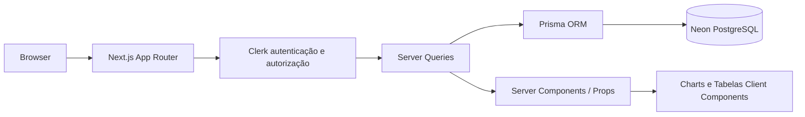
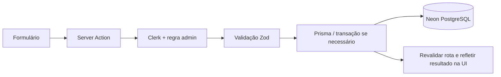

# ARCHITECTURE.md — Arquitetura e limites do MVP

## Escopo

Dashboard ADM organizacional: pessoas, departamentos, KPIs, gráficos, filtros e relatórios. Aplicação Full Stack independente da base de dados do PrismaOfertas, embora reutilize ideias e tecnologias.

Referência aprovada: D-006 (2026-11-04). Os cinco módulos são Dashboard, Analytics, Pessoas, Departamentos e Relatórios. Preservar os oito modelos atuais; `Person` e `PersonAssignment` são as referências de pessoas e vínculos. O guia original fica como histórico, sem precedência sobre esta arquitetura.

## Operação com uma organização

A organização operacional deve existir e ser selecionada por configuração confiável no servidor, validada a cada contexto de acesso. Não aceitar `organizationId` do cliente como fonte de autoridade. Na ausência de configuração ou organização válida, negar acesso aos dados; não escolher a primeira organização nem criar uma automaticamente.

Clerk autentica; uma allowlist de IDs administrativos autoriza. Não haverá seletor de organizações, webhooks de provisionamento ou RBAC no MVP. Preservar `Organization.clerkOrgId`, obrigatório no schema, com identificação/provisionamento planejados em T4.1 sem inventar vínculo com Clerk. Operações de provisionamento precisam de autorização própria.

Todas as queries, actions e exportações exigem autenticação, autorização e filtro organizacional. IDs relacionados (pessoa, cargo, departamento e eventual gestor) devem pertencer à mesma organização. As FKs atuais não garantem sozinhas essa coerência; validar no servidor e testar negações, inclusive concorrência em mutações.

## Fluxo de leitura

## Fluxo de escrita

## Organização de camadas

- **`src/app`**: rotas, layout, tratamento de estados; sem lógica de banco complexa.
- **`src/components`**: apresentação reutilizável, Client Components somente quando necessário.
- **`src/server/queries`**: leituras e agregações protegidas, com dados mínimos ao cliente.
- **`src/server/actions`**: mutações protegidas e validadas.
- **`src/lib`**: cliente Prisma, guard de admin, parsers/filtros, utilidades, esquemas Zod.
- **`prisma`**: schema/migrações/seed apenas após aceite explícito.
- **`tests`**: unidade/integração/E2E, selecionados conforme a camada.

## Segurança

1. No MVP existe **um ambiente administrativo** e uma lista explícita de contas autorizadas (IDs Clerk aprovados, somente em variável de ambiente no servidor). O login por si só não concede acesso.
2. Conferir autenticidade com Clerk, autorização admin no servidor e filtros permitidos antes de todas as consultas, mutações e exportações.
3. `proxy.ts` pode direcionar rotas e preparar o Clerk, mas não substitui verificações em Queries, Actions e handlers.
4. Nunca usar segredos no navegador nem confiar em um `userId` fornecido pelo cliente.
5. Seed usa dados fictícios; ambiente de demonstração não contém dados pessoais reais.
6. Nunca aplicar migração automaticamente na produção a partir do Codex sem procedimento explícito.

## Métricas do MVP

O contrato completo e os limites históricos estão em [DATA_MODEL.md](DATA_MODEL.md). Usar um único instante de referência `t` por consulta e dados da organização autorizada, excluindo registros arquivados.

- **Total de colaboradores:** pessoas únicas com `hiredAt <= t`, incluindo desligadas.
- **Ativos:** pessoas desse total com `terminatedAt` nulo ou posterior a `t`.
- **Departamentos:** departamentos não arquivados da organização, inclusive vazios.
- **Admissões no período:** pessoas únicas com `hiredAt` em `[start, end)` e até `t`, independentemente de desligamento posterior.
- **Série mensal:** mesmas admissões agrupadas por mês de `America/Sao_Paulo`.
- **Distribuição:** pessoas ativas por departamento do único vínculo vigente em `t`; incluir departamentos vazios e categoria explícita para inconsistências. Não multiplicar pessoas por joins.
- **Rosca:** ativos versus inativos (desligamento já ocorrido); a soma coincide com o total. Admissões futuras ficam fora do quadro atual.
- **Admissões recentes:** pessoas admitidas até `t`, por `hiredAt DESC, id DESC`, limite definido na query.

Todos os cards devem informar se são números **atuais** ou do **período selecionado**. Não apresentar “crescimento percentual” sem comparação histórica definida.

O filtro de período altera admissões e sua série, sem alterar total atual, ativos, departamentos, barras ou rosca. Analytics detalha as mesmas definições. Não usar `MetricSnapshot` como fonte no MVP nem ativar jobs de preenchimento.

## Cadastros e integridade

`PersonAssignment` associa pessoa, departamento e cargo em `[startDate, endDate)`. `endDate = null` representa intervalo sem fim conhecido, não prova isolada de vigência. Trocas de cargo/departamento encerram o vínculo e abrem o próximo no mesmo instante, em transação. Desligamento encerra o vínculo na data de `terminatedAt`, também em transação, sem apagar histórico. Concorrência e garantia contra sobreposição precisam de revisão em T4/T6; a existência do SQL manual não comprova sua aplicação no banco.

Novos vínculos devem usar `Department` e `Position` não arquivados da mesma organização. O cadastro de pessoa e vínculo inicial é atômico. Ausência ou sobreposição de vínculos bloqueia a mutação para revisão, sem correção automática. Desligamento difere de arquivamento (`deletedAt`). Não oferecer exclusão física. Departamentos só podem ser arquivados sem vínculos vigentes/futuros e sem filhos não arquivados; manter referências históricas.

`Position` será um catálogo de apoio selecionável, sem tela de manutenção avançada. T4.1 apresentará o catálogo mínimo e o procedimento para reaproveitar cargos existentes ou provisionar os ausentes, por organização, sem reset, após aprovação específica. O formulário deverá informar indisponibilidade de cargos, sem criar registros implícitos. O seed existente não está liberado para execução.

Não editar retroativamente vínculos, recontratar nem criar vínculos simultâneos no MVP. Hierarquias existentes são preservadas; não oferecer edição de gestores/árvore. Se houver subordinados, o fluxo de desligamento fica bloqueado até existir procedimento aprovado para manter a hierarquia, sem reatribuição silenciosa.

## Recursos preservados para o futuro

Multitenancy completo, organograma, administração avançada de cargos/hierarquias, auditoria funcional (`AuditLog`), snapshots (`MetricSnapshot`), agendamentos (`ReportSchedule`) e jobs Inngest ficam fora do MVP. Isso não autoriza remover modelos, relações, dados, SQL manual ou dependências. Histórico de vínculos é necessário à integridade; uma interface de histórico e auditoria completa são entregas distintas e futuras.

## Padrão de datas

Filtros de período devem usar `America/Sao_Paulo` como contexto de dia/mês de negócio e construir instantes UTC correspondentes. O intervalo é início inclusivo/fim exclusivo (`[start, end)`). Armazenar `hiredAt` em `DateTime`; testar virada de mês e ano.

## Desempenho

- Agrupar/contar no banco sempre que possível; paginação server-side.
- Evitar trazer todos os colaboradores para o client para agregar.
- Avaliar os índices existentes por organização em `Person.hiredAt`, `Person.terminatedAt` e `PersonAssignment` para pessoa/departamento/vigência; qualquer alteração de schema exige aprovação.
- `cacheComponents` já está habilitado na base. Isso não aprova caching de consultas privadas: definir chave com organização/autorização e invalidação antes de usar cache explícito para esses dados.

## Interface

- Visual limpo e profissional, fundo claro, tipografia discreta, tons slate com toques indigo/fuchsia da linguagem visual PrismaOfertas.
- Largura responsiva, sidebar colapsável, cabeçalho com contexto, cartões e gráficos acessíveis.
- Usar componentes shadcn/ui existentes; não sobrescrever classes, tokens ou CSS globais já existentes sem autorização.
- Gráficos devem apresentar título, legenda, tooltip e equivalente textual/tabela quando relevante.

## Ordem de implementação

Auditoria → conciliação documental → organização/versionamento (T0.3, mediante autorização) → baseline/CI → shell demonstrativo → auth/admin/escopo → preparação dos dados existentes → KPIs reais → CRUD → Analytics/relatórios → E2E/deploy. Cada tarefa exige autorização própria.

## Observações de compatibilidade

Se a base estiver em Next.js 16, `proxy.ts` é a convenção atual; o `auth()` do Clerk é assíncrono. Verificar `cacheComponents` e limites de Suspense antes de adotar exemplos genéricos. Manter a versão de Prisma do repositório no primeiro ciclo salvo uma decisão expressa de migração.
