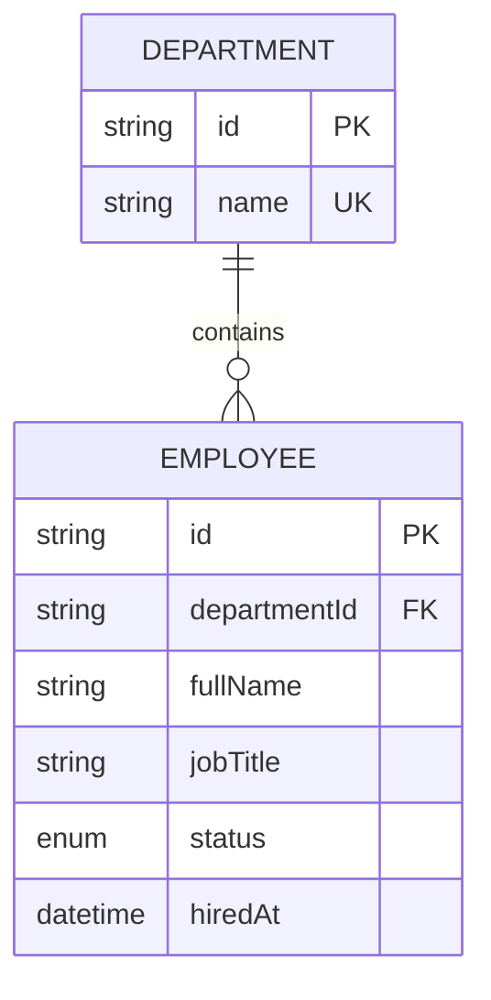

# DATA_MODEL.md — Modelo vigente e regras do MVP

## Referência aprovada em D-006

Preservar provisoriamente o schema existente, sem alterações ou execução de migrations/seed nesta conciliação. `Person` e `PersonAssignment` são as referências do domínio. O banco remoto não foi inspecionado; schema local e SQL manual não comprovam estrutura ou constraints aplicadas no ambiente.

| Modelo | Estrutura relevante existente | Uso |
| --- | --- | --- |
| `Organization` | `id`, `clerkOrgId` único obrigatório, `name` | Organização operacional selecionada no servidor; sem provisionamento automático |
| `Department` | `organizationId`, `parentId`, `name`, `deletedAt`, datas | Cadastro; hierarquia preservada sem editor de árvore |
| `Position` | `organizationId`, `title`, `level`, `deletedAt`, datas | Catálogo de cargos de apoio aos vínculos |
| `Person` | `organizationId`, `name`, `email` obrigatório, `hiredAt`, `terminatedAt`, `deletedAt`, `managerId`, `clerkUserId`, `avatarUrl`, datas | Pessoa; email único por organização; login não é obrigatório para cada pessoa |
| `PersonAssignment` | `organizationId`, `personId`, `departmentId`, `positionId`, `startDate`, `endDate`, `createdAt` | Cargo/departamento por vigência; sem campo de status persistido |
| `MetricSnapshot` | organização, data, chave, dimensão e valor | Preservado para agregações futuras |
| `AuditLog` | organização, ator, ação, entidade, antes/depois e data | Preservado para auditoria futura |
| `ReportSchedule` | organização, frequência `ReportFrequency`, destinatários e controle de execução | Preservado para agendamento futuro |

Relacionamento operacional: `Organization` contém pessoas, departamentos e cargos; `PersonAssignment` referencia os três últimos. Não existem `Employee`, `EmploymentStatus`, `Person.departmentId`, `Person.jobTitle` ou `Department.description` no schema atual. A unicidade de departamentos é composta por organização/pai/nome, não um nome global único; valores nulos de pai e normalização exigem revisão na validação futura.

## Contrato dos indicadores

Toda consulta deve autenticar e autorizar administrador, resolver a organização no servidor e limitar também relações e exportações a esse escopo. Excluir `Person.deletedAt != null` das métricas operacionais. Fixar um instante UTC `t` para todos os cálculos de uma resposta. Registros com desligamento anterior à admissão ou relações entre organizações são inconsistências: não produzir indicadores silenciosamente como se fossem válidos; retornar estado de erro de integridade para revisão autorizada.

### Contagem única e situação

- Unidade de contagem: `Person.id`, uma vez por indicador. Agregar no banco; joins com vários vínculos não podem inflar KPIs, tabelas, paginação ou CSV.
- Total: pessoas não arquivadas com `hiredAt <= t`, incluindo desligadas.
- Ativa: pessoa do total com `terminatedAt = null` ou `terminatedAt > t`.
- Inativa: pessoa do total com `terminatedAt <= t`. Logo, ativos + inativos = total.
- Admissão futura (`hiredAt > t`): situação agendada, fora de total/ativos/inativos atuais. Pode aparecer em listagem específica, com rótulo explícito, sem ser confundida com inativa.
- Desligamento futuro não torna a pessoa inativa antes de sua data. No instante do desligamento ela já é inativa; `deletedAt` não participa dessa classificação.
- Total de departamentos: `Department` da organização com `deletedAt = null`, inclusive vazios e todos os níveis já existentes. Não somar filhos recursivamente sobre os próprios registros.

### Período e admissões

Admissões contam pessoas únicas com `start <= hiredAt < end` e `hiredAt <= t`. Um desligamento posterior à admissão não elimina essa admissão. A série mensal usa o mesmo conjunto, agrupado por mês de `America/Sao_Paulo`, preenchendo meses sem admissões com zero. Não usar `createdAt` ou quantidade de assignments como admissão.

Filtros de dia/mês usam `America/Sao_Paulo` e são convertidos para instantes UTC; data final inclusiva na interface vira início do dia seguinte exclusivo na consulta. Não assumir que toda conversão pode ser feita somando 24 horas. Períodos futuros não contam admissões ainda não ocorridas. Exibir o corte em `t` quando o intervalo ultrapassá-lo.

O período selecionado afeta admissões e série temporal, não os indicadores atuais. Admissões recentes seguem `hiredAt DESC, id DESC`, até `t`, com limite explícito. A soma dos meses deve coincidir com admissões do mesmo intervalo e instante de referência.

### Vínculo vigente e distribuição por departamento

Vínculo vigente em `t`: `startDate <= t` e (`endDate = null` ou `endDate > t`), com pessoa/cargo/departamento na mesma organização. Intervalos são `[startDate, endDate)`; vínculo futuro ou encerrado não é vigente. Novos intervalos exigem `endDate > startDate` quando houver fim.

As barras mostram **pessoas ativas**, não todas as pessoas já admitidas. Para cada ativa, usar exatamente um vínculo vigente e referências não arquivadas. Departamentos vazios aparecem com zero. Sem vínculo, com múltiplos vínculos vigentes ou referência arquivada, contar a pessoa uma única vez na categoria **Vínculo inconsistente**, sinalizando a causa sem escolher um vínculo arbitrário. Relações de outra organização não devem ser expostas e provocam erro de integridade. Soma das barras mais inconsistências = total de ativos. Uma troca no instante `t` conta apenas no novo vínculo.

### Relatórios e histórico

Relatórios retornam uma linha por pessoa: ativos usam o vínculo vigente; inativos usam o último vínculo encerrado até `terminatedAt`, ordenado por `endDate DESC, startDate DESC, id DESC`. O desempate torna a consulta estável, sem legitimar vínculos sobrepostos: validar intervalos e sinalizar inconsistências. Reter rótulos dos cargos/departamentos arquivados usados no histórico, sem torná-los selecionáveis para novos vínculos. O filtro de departamento usa essa mesma associação apresentada na linha; não significa qualquer passagem histórica pelo departamento. Agendados usam vínculo vigente em `hiredAt`, com rótulo de previsão. Ausência ou ambiguidade aparece como inconsistência.

`PersonAssignment` preserva histórico de cargo/departamento, mas não versões anteriores de nomes, emails, gestores, arquivamentos e todas as correções. As métricas operacionais usam o cadastro conhecido hoje, excluindo arquivados, e não equivalem a uma fotografia auditável do passado. Não oferecer turnover, quadro histórico completo, backfill ou comparações históricas sem definição e tarefa própria. `MetricSnapshot` e `AuditLog` não são fontes do MVP.

## Mutações e preservação do histórico

- Cadastro de pessoa e vínculo inicial: transação, departamento/cargo válidos da mesma organização e data inicial igual a `hiredAt`.
- Troca atual de cargo/departamento: fechar o vínculo vigente e abrir o seguinte no mesmo instante, em transação; nunca apagar o vínculo anterior. Bloquear ausência/sobreposição de vínculos até revisão.
- Desligamento: preencher `terminatedAt` e encerrar o vínculo nesse instante em transação. Se for agendado, a vigência e situação devem permanecer coerentes até a data. Bloquear vínculos futuros conflitantes e subordinados sem procedimento aprovado; não reassociar pessoas silenciosamente.
- Arquivamento é distinto de desligamento. O MVP oferece desligamento, sem exclusão física de pessoas ou edição direta de `deletedAt` como substituto de término do contrato.
- Departamento: arquivar somente sem vínculos vigentes/futuros e filhos não arquivados; preservar assignments passados. Mudanças hierárquicas e manutenção avançada de cargos ficam para o futuro.
- Recontratação, vínculos simultâneos e edição retroativa ficam fora do MVP. Mudanças em `hiredAt` ou `terminatedAt` que reescrevam histórico existente devem ser bloqueadas e encaminhadas para procedimento específico.
- O SQL manual de exclusão de sobreposição deve ser avaliado em T4.1. Não pressupor que esteja aplicado nem que validação isolada antes da escrita resolva concorrência; definir proteção transacional e testes em T4/T6.

## Disponibilização futura de cargos e organização

T4.1 deverá inventariar registros apenas quando o acesso ao ambiente for autorizado e apresentar catálogo mínimo de cargos e organização operacional, incluindo o tratamento de `Organization.clerkOrgId`. Reaproveitar `Position` existente, da organização e não arquivado; criar ausentes apenas por procedimento aprovado e idempotente, sem apagar ou recriar a organização. Documentar normalização, unicidade por organização/título, conflitos, ambiente, impacto e rollback.

T4.3 revisará o seed atual antes de qualquer execução: ele depende de Faker ausente, usa data atual e apaga/recria dados da organização selecionada. Provisionamento do catálogo não deve depender desse reset. Aprovação da documentação não autoriza editar nem executar seed. Sem cargos válidos, o formulário informa a pendência e bloqueia a criação, sem cargo textual ou registro implícito.

## Validação futura e índices

Testar contagem única com múltiplos vínculos históricos, duas organizações, arquivados, admissões/desligamentos futuros, término exatamente em `t`, viradas de mês/ano, vínculos adjacentes/sobrepostos/ausentes, referências arquivadas, reconciliação dos gráficos e filtros de relatório. Avaliar os índices já existentes de organização/admissão/desligamento e organização/pessoa/departamento/vigência; qualquer mudança exige proposta e aprovação próprias.

## Alternativa anterior preservada — substituída por D-006

O conteúdo abaixo registra a proposta original associada a D-003. Suas entidades, fórmulas, índices e instruções de aprovação não são o contrato vigente nem autorizam implementação. D-006 preserva o schema existente e as regras acima.

## Modelos para o MVP

### Department

| Campo | Tipo conceitual | Regra |
| --- | --- | --- |
| `id` | String/cuid | chave primária |
| `name` | String | obrigatório, único após normalização/validação |
| `description` | String? | opcional |
| `createdAt` | DateTime | gerado pelo servidor |
| `updatedAt` | DateTime | atualizado automaticamente |
| `employees` | relação 1:N | colaboradores vinculados |

### Employee

| Campo | Tipo conceitual | Regra |
| --- | --- | --- |
| `id` | String/cuid | chave primária |
| `fullName` | String | obrigatório |
| `email` | String? | opcional; tratar duplicados se informado |
| `jobTitle` | String | cargo textual no MVP, sem tabela própria |
| `status` | EmploymentStatus | `ACTIVE`, `INACTIVE` |
| `hiredAt` | DateTime | admissão; base para gráficos de período |
| `departmentId` | String | FK para departamento existente |
| `department` | relação N:1 | departamento atual |
| `createdAt` | DateTime | criado no sistema |
| `updatedAt` | DateTime | última edição |

**Não incluir** salários, avaliações, CPF ou dados pessoais desnecessários. Usar dados fictícios.

### Enum EmploymentStatus

`ACTIVE` e `INACTIVE`. Não confundir status atual com histórico de desligamento; turnover real requer eventos históricos e outro modelo.

## Relacionamento

## Regras de cálculo

| Informação | Regra |
| --- | --- |
| Total de colaboradores | Todos os registros de `Employee` (inclui inativos) |
| Colaboradores ativos | Registros com `status=ACTIVE` |
| Departamentos | Todos os departamentos cadastrados |
| Admitidos no período | `hiredAt >= start` e `hiredAt < end` |
| Admissões por mês | Agrupar `hiredAt` em meses de `America/Sao_Paulo` |
| Pessoas por departamento | Contar registros de pessoas vinculados, inclusive inativos; mostrar zeros |
| Status | Contagem atual ativa/inativa |
| Admissões recentes | Ordenar `hiredAt DESC`, com limite definido |

Datas de negócio e limites do período são interpretados em `America/Sao_Paulo`. As agregações temporais precisam de testes de virada de mês e ano. Evitar contar `createdAt` como admissão.

## Política de exclusão

- Pessoa: preferir **inativação** a exclusão física no MVP.
- Departamento: impedir exclusão quando existem colaboradores vinculados, salvo fluxo de transferência aprovado.
- Sem histórico de eventos, o MVP **não informa** taxa de turnover nem quadro histórico em determinada data.

## Índices propostos (a revisar na aprovação do schema)

- `Employee.departmentId`
- `Employee.status`
- `Employee.hiredAt`

## Aprovação exigida

Antes de escrever `schema.prisma`, confirmar compatibilidade com o banco existente, riscos, plano de migração, índices e necessidade de atualização de relações. Registrar a decisão `D-003` em `DECISIONS.md`.
